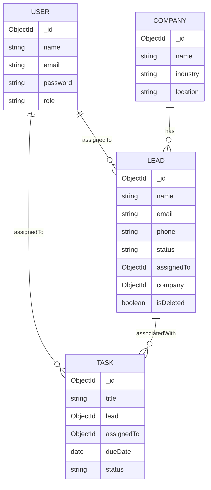

# Mini CRM – Business Operations Platform

A production-minded, clean, and reliable Full Stack MERN (MongoDB, Express, React, Node.js) Mini CRM application built for real-world enterprise management. 

Designed with a restrained, minimal interface adhering to genuine business software design principles (Material-UI with a centralized design system, no gratuitous animations or AI dashboard tropes), full RESTful API endpoints, robust backend authorization, MongoDB aggregation pipelines, and comprehensive soft-deletion mechanisms.

---

## 1. Table of Contents
- [Main Features](#2-main-features)
- [Technology Stack](#3-technology-stack)
- [Folder & Architectural Structure](#4-folder--architectural-structure)
- [Database Models & Relationships](#5-database-models--relationships)
- [Authentication Flow](#6-authentication-flow)
- [Critical Authorization Logic (Task Status Ownership)](#7-critical-authorization-logic-task-status-ownership)
- [API Endpoints Reference](#8-api-endpoints-reference)
- [Local Setup Instructions](#9-local-setup-instructions)
- [Connecting to MongoDB Atlas (Quick Guide)](#10-connecting-to-mongodb-atlas-quick-guide)
- [Seed Data & Sample Credentials](#11-seed-data--sample-credentials)
- [Testing & Verification](#12-testing--verification)
- [Deployment Guide](#13-deployment-guide)

---

## 2. Main Features

- **Authentication & Role Authorization**: Secure login with bcrypt hashing, JWT access token claims, HttpOnly cookie support, and protected route wrappers.
- **Operations Dashboard**: Four real-time pipeline statistics calculated via **MongoDB Aggregation Pipelines** (`$facet`, `$group`, `$cond`):
  1. *Total Leads* (active, excluding soft-deleted)
  2. *Qualified Leads* (filtered on status)
  3. *Tasks Due Today* (calendar date boundary match)
  4. *Completed Tasks*
- **Leads Module (CRUD & Soft Deletion)**:
  - Search by lead name and email.
  - Filter by pipeline status (`New`, `Contacted`, `Qualified`, `Lost`).
  - Server-side pagination.
  - Non-destructive **Soft Deletion** (`isDeleted: true`), preventing accidental deletion and strictly excluding records from queries, detail lookups, dashboard stats, and company associations.
- **Companies Module**:
  - Directory of enterprise accounts.
  - Company detail view displaying organizational data and real-time **active associated leads**.
- **Tasks & Follow-ups Module (Strict Assignee Ownership)**:
  - Scheduling follow-ups linked to specific leads and users.
  - **Backend-enforced status update authorization**: only the assigned user can update a task's status; unauthorized users receive an HTTP 403 Forbidden.
- **Design & UI**:
  - Centralized Material-UI (MUI) v6 theme tokens.
  - Consistent neutral background (`#f8fafc`), crisp slate text (`#0f172a`), subtle 1px borders (`#e2e8f0`), and semantic chips.
  - Fully responsive with mobile drawer and desktop persistent navigation.

---

## 3. Technology Stack

### Frontend
- **React (v18)** & **JavaScript (ES6+)**
- **Vite** build tooling & bundler
- **React Router DOM (v6)** for declarative and protected routing
- **Axios** with centralized base instance and authorization interceptors
- **Material-UI (MUI v6)** & Emotion
- **React Context API** for authentication state management

### Backend
- **Node.js** & **Express.js** (MVC architecture)
- **MongoDB** & **Mongoose**
- **JSON Web Tokens (jsonwebtoken)** for stateless authentication
- **bcryptjs** for 10-salt-round password hashing
- **cookie-parser** and **cors**

---

## 4. Folder & Architectural Structure

```
mini-crm/
├── client/                     # Frontend Vite + React application
│   ├── src/
│   │   ├── assets/             # Static logos and graphics
│   │   ├── components/
│   │   │   ├── common/         # StatCard, StatusChip, ConfirmDialog
│   │   │   └── layout/         # Sidebar, Topbar
│   │   ├── context/            # AuthContext (user, token, session)
│   │   ├── layouts/            # AppLayout (drawer, topbar, outlet)
│   │   ├── pages/
│   │   │   ├── auth/           # LoginPage
│   │   │   ├── dashboard/      # DashboardPage (MongoDB stats)
│   │   │   ├── leads/          # LeadsListPage, LeadFormDialog
│   │   │   ├── companies/      # CompaniesListPage, CompanyDetailPage, CompanyFormDialog
│   │   │   └── tasks/          # TasksListPage, TaskFormDialog
│   │   ├── routes/             # AppRoutes, ProtectedRoute
│   │   ├── services/           # Axios API services (auth, leads, companies, tasks, dashboard)
│   │   ├── theme/              # Centralized MUI theme (colors, typography, component overrides)
│   │   ├── App.jsx             # Top-level providers
│   │   └── main.jsx            # React root mount
│   ├── index.html
│   ├── vite.config.js
│   └── package.json
│
├── server/                     # Backend Node.js + Express API
│   ├── config/
│   │   └── db.js               # MongoDB connection handler
│   ├── controllers/
│   │   ├── authController.js   # Login, getMe, logout
│   │   ├── userController.js   # List users for dropdowns
│   │   ├── leadController.js   # Leads CRUD, search, pagination, soft-delete
│   │   ├── companyController.js# Companies CRUD & associated leads lookup
│   │   ├── taskController.js   # Tasks CRUD & assignee ownership enforcement
│   │   └── dashboardController.js # Real MongoDB aggregation pipelines
│   ├── middleware/
│   │   ├── auth.js             # protect (JWT verification) & authorize (roles)
│   │   └── errorHandler.js     # Centralized error handling & CastError/duplicate key formatting
│   ├── models/
│   │   ├── User.js             # User schema with bcrypt pre-save & toJSON password exclusion
│   │   ├── Company.js          # Company schema with search indexes
│   │   ├── Lead.js             # Lead schema with soft-delete index & ObjectId refs
│   │   └── Task.js             # Task schema with dueDate & assignee indexes
│   ├── routes/                 # Express API routes
│   ├── utils/
│   │   ├── jwt.js              # Token generation and verification
│   │   ├── seed.js             # Automated seed script with realistic business data
│   │   └── testVerification.js # Automated verification test suite
│   ├── validators/             # Request payload validation
│   ├── app.js                  # Express middleware & route mounting
│   ├── server.js               # HTTP listener & DB initiator
│   └── package.json
└── README.md
```

---

## 5. Database Models & Relationships

- **User**: `name`, `email` (unique), `password` (hashed, excluded by default), `role` (`Admin` | `User`), `timestamps`.
- **Company**: `name`, `industry`, `location`, `description`, `timestamps`.
- **Lead**: `name`, `email`, `phone`, `status` (`New` | `Contacted` | `Qualified` | `Lost`), `assignedTo` (ref `User`), `company` (ref `Company`), `isDeleted` (Boolean default `false`), `timestamps`.
- **Task**: `title`, `description`, `lead` (ref `Lead`), `assignedTo` (ref `User`), `dueDate`, `status` (`Pending` | `In Progress` | `Completed`), `timestamps`.



---

## 6. Authentication Flow

1. The client sends a `POST /api/auth/login` with `email` and `password`.
2. The backend retrieves the user (including the hidden `password` field) and executes `bcrypt.compare`.
3. Upon matching, a JWT token is signed containing the user's `id`, `name`, `email`, and `role`.
4. The token is sent in the JSON response payload and also as an `HttpOnly` cookie.
5. Frontend stores the token and configures Axios request interceptors to append `Authorization: Bearer <token>`.
6. Private routes are gated by the `protect` middleware, which verifies the token, queries the active user, and attaches `req.user`.

---

## 7. Critical Authorization Logic (Task Status Ownership)

> [!IMPORTANT]
> **Interviewer Specification Enforced**: Even if a user sends a manual HTTP PATCH request via Postman, curl, or dev tools, they **cannot** update another user's task status.

The logic is enforced inside `server/controllers/taskController.js`:

```javascript
// PATCH /api/tasks/:id/status
const updateTaskStatus = async (req, res, next) => {
  const { status } = req.body;
  
  // 1. Validate status enum value
  if (!['Pending', 'In Progress', 'Completed'].includes(status)) {
    return res.status(400).json({ success: false, message: 'Invalid status value.' });
  }

  // 2. Query the requested task
  const task = await Task.findById(req.params.id);
  if (!task) {
    return res.status(404).json({ success: false, message: 'Task not found.' });
  }

  // 3. Compare assigned user ID with authenticated JWT user ID
  if (task.assignedTo.toString() !== req.user._id.toString()) {
    return res.status(403).json({
      success: false,
      message: 'Forbidden: Only the user assigned to this task can update its status.',
    });
  }

  // 4. Authorized: Update status and save
  task.status = status;
  await task.save();
  res.status(200).json({ success: true, data: task });
};
```

---

## 8. API Endpoints Reference

### Authentication & Users
- `POST /api/auth/login` – Authenticate credentials and receive token.
- `GET /api/auth/me` – Retrieve current authenticated user profile.
- `POST /api/auth/logout` – Clear auth session.
- `GET /api/users` – List active team members for dropdown assignments.

### Dashboard
- `GET /api/dashboard/stats` – Computes pipeline metrics using MongoDB `$facet` & `$group` aggregations.

### Leads
- `GET /api/leads?page=1&limit=10&search=keyword&status=Qualified` – Paginated, filtered active leads.
- `POST /api/leads` – Create lead with company and assignee relationships.
- `GET /api/leads/:id` – Retrieve lead details (excludes soft-deleted).
- `PUT /api/leads/:id` – Update lead information.
- `PATCH /api/leads/:id/status` – Update lead status.
- `DELETE /api/leads/:id` – Soft-deletes lead (`isDeleted = true`).

### Companies
- `GET /api/companies?search=name` – List all companies.
- `POST /api/companies` – Create new company.
- `GET /api/companies/:id` – Get company profile + associated active leads.
- `PUT /api/companies/:id` – Update company details.

### Tasks
- `GET /api/tasks?status=Pending` – List scheduled tasks.
- `POST /api/tasks` – Create and schedule a task.
- `GET /api/tasks/:id` – Get task details.
- `PATCH /api/tasks/:id/status` – Update task status (**strictly restricted to task assignee**).

---

## 9. Local Setup Instructions

### Prerequisites
- Node.js (v18+ or v20+)
- npm or pnpm

### 1. Clone or Open Workspace
```bash
cd mini-crm
```

### 2. Backend Setup
```bash
cd server
npm install
```
Configure `server/.env` (see below for MongoDB Atlas URI instructions).

### 3. Frontend Setup
```bash
cd ../client
npm install
```

### 4. Running the Development Servers
In terminal 1 (Server):
```bash
cd server
npm run dev
# Server will run on http://localhost:5000
```

In terminal 2 (Client):
```bash
cd client
npm run dev
# Vite client will open on http://localhost:5173
```

---

## 10. Connecting to MongoDB Atlas (Quick Guide)

If you don't have MongoDB installed locally, you can get a free MongoDB Atlas database in under 2 minutes:

1. Go to [MongoDB Atlas](https://www.mongodb.com/cloud/atlas) and sign in (or create a free account).
2. Click **Create a Database** and select the **M0 Free Tier**.
3. Under **Security Quickstart**:
   - Create a database user (e.g., username: `crmuser`, password: `<your-password>`).
   - Under **Network Access**, add IP Address `0.0.0.0/0` (Allow access from anywhere).
4. Click **Connect** -> **Drivers** (Node.js).
5. Copy the connection string and paste it into `server/.env`:
   ```env
   MONGODB_URI=mongodb+srv://crmuser:<your-password>@cluster0.xxxxx.mongodb.net/mini_crm?retryWrites=true&w=majority
   ```

---

## 11. Seed Data & Sample Credentials

To populate your database with 1 Admin user, 3 Normal users, 5 Companies, 15 Leads, and 10 Tasks (including tasks due today):

```bash
cd server
npm run seed
```

### Sample Evaluation Accounts

| Role | Name | Email | Password |
|---|---|---|---|
| **Admin** | Alexander Ross | `admin@crm.local` | `Password123!` |
| **User (Sales)** | Alice Walker | `alice@crm.local` | `Password123!` |
| **User (Accounts)** | Bob Martin | `bob@crm.local` | `Password123!` |
| **User (Sales)** | Charlie Davis | `charlie@crm.local` | `Password123!` |

---

## 12. Testing & Verification

Run the automated integration and authorization verification suite:

```bash
cd server
node utils/testVerification.js
```

This verifies:
1. Password hashing with bcrypt.
2. JWT signature claims (user ID & role).
3. Soft deletion filtering across queries.
4. Company-lead relational population.
5. Task status ownership authorization (verifying 403 Forbidden condition when a non-assignee modifies status).
6. MongoDB aggregation pipeline outputs for dashboard statistics.

---

## 13. Deployment Guide

### Backend (Render / Railway / Heroku)
- Root Directory: `server`
- Build Command: `npm install`
- Start Command: `node server.js`
- Environment Variables:
  - `NODE_ENV=production`
  - `PORT=5000`
  - `MONGODB_URI=<your-atlas-connection-string>`
  - `JWT_SECRET=<secure-random-secret>`
  - `CLIENT_URL=https://<your-frontend-domain>.netlify.app`

### Frontend (Netlify / Vercel)
- Root Directory: `client`
- Build Command: `npm run build`
- Publish Directory: `dist`
- Environment Variables:
  - `VITE_API_BASE_URL=https://<your-backend-domain>.onrender.com/api`
- Single Page Application Redirects: include `client/public/_redirects` with `/*  /index.html  200`.

---
*Mini CRM Business Operations Platform — Built with clean architecture, strict authorization, and attention to real-world software engineering principles.*

